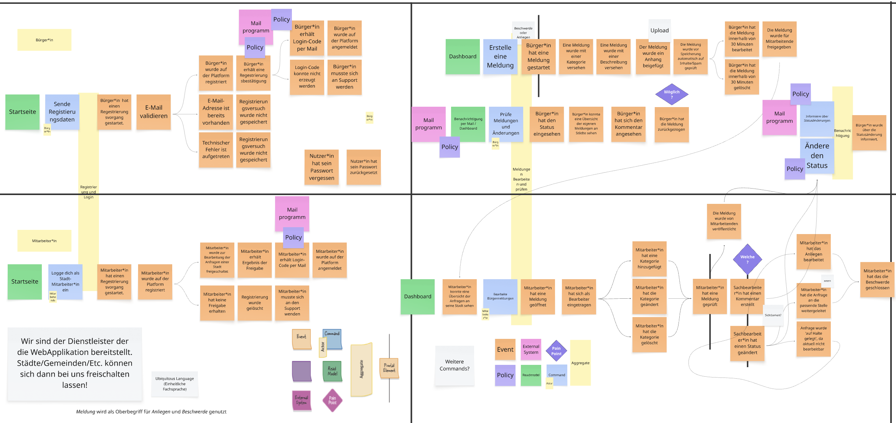
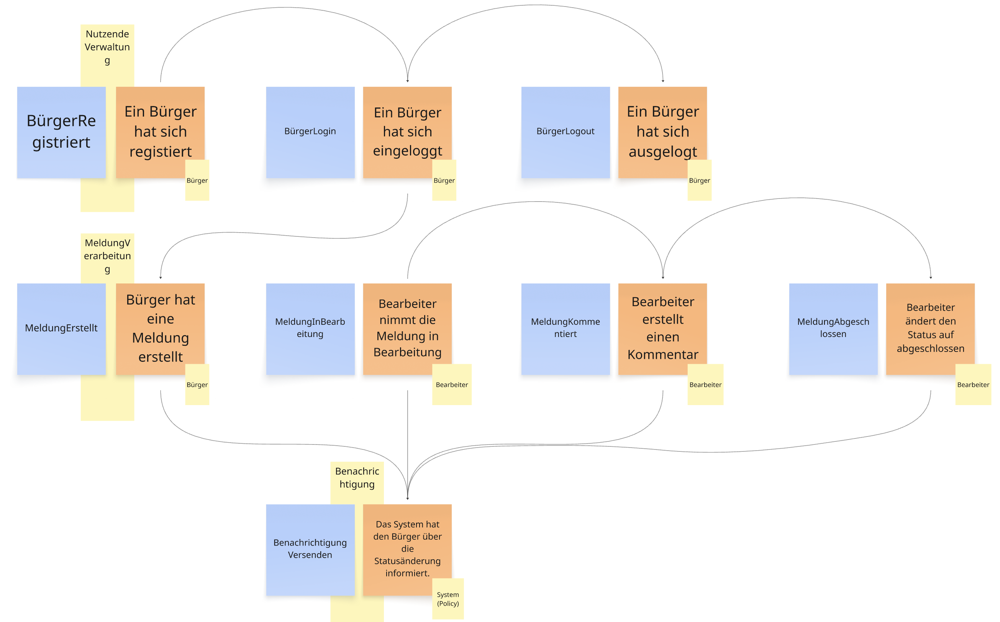
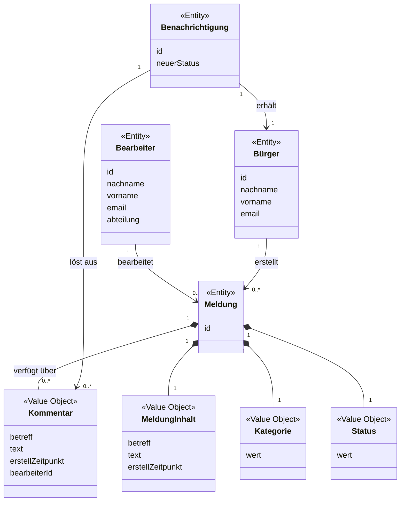
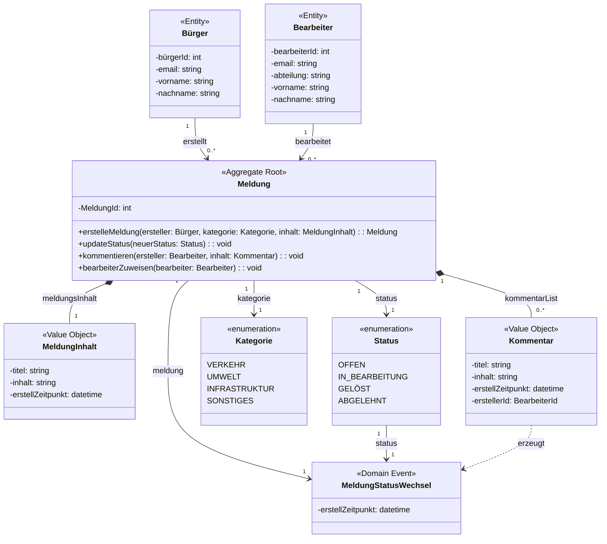

# CityFeedback

Semesteraufgabe im Modul "Moderne Softwareentwicklung" WS 26/27

## Inhaltsverzeichnis
- [Übung 1: Einführung in Git](#übung-1-einführung-in-git)
  - [Was ist Git und warum sollte es verwendet werden?](#was-ist-git-und-warum-sollte-es-verwendet-werden)
  - [Grundlegende Git-Befehle – Spickzettel & Referenz](#grundlegende-git-befehle--spickzettel--referenz)
  - [Branches und der Umgang mit Merge-Konflikten](#branches-und-der-umgang-mit-merge-konflikten)
  - [Git mit IntelliJ benutzen](#git-mit-intellij-benutzen)
  - [Nützliche Git-Tools und Plattformen](#nützliche-git-tools-und-plattformen)
- [Übung 2: CI/CD Pipeline](#übung-2-cicd-pipeline)
  - [Grundlegende Konzepte](#grundlegende-konzepte)
  - [Wie CI/CD unsere Softwareentwicklung unterstützt](#wie-cicd-unsere-softwareentwicklung-unterstützt)
  - [Wahl der Plattform: GitHub Actions](#wahl-der-plattform-github-actions)
  - [Repositorystruktur](#repositorystruktur)
  - [Konzept: Aufbau der Pipeline](#konzept-aufbau-der-pipeline)
  - [Konzept: Continuous Deployment](#konzept-continuous-deployment)
  - [Bonus: Erweiterungen der Pipeline](#bonus-erweiterungen-der-pipeline)
- [Übung 3: UML & OOD (DDD)](#übung-3-uml--ood-ddd)
  - [Event Storming durchführen](#event-storming-durchführen)
  - [Domain-Modell (grobe Gesamtsicht)](#domain-modell-grobe-gesamtsicht)
  - [Bounded Contexts](#bounded-contexts)
  - [Entitäten und Aggregates definieren (Detail pro Context)](#entitäten-und-aggregates-definieren-detail-pro-context)
  - [Domain Services und Repositories](#domain-services-und-repositories)
  - [Implementierungsstrategie](#implementierungsstrategie)


# Übung 1: Einführung in Git

## Was ist Git und warum sollte es verwendet werden?

Git ist eine Software zur Versionierung von Dateien, die es Teams ermöglicht, zeitgleich an einem Projekt und sogar gleichen Projektdateien zu arbeiten und diese im Anschluss zusammenzuführen.

Werden die Projektdateien über Git verwaltet, können Teammitglieder auf separaten (Feature-)Branches arbeiten und diese anschließend auf einem Haupt-Branch zusammenführen. Die so entstehenden Unterschiede (gelöschte, geänderte, hinzugefügte Zeilen) sind klar erkennbar. Ggf. entstehende Merge-Konflikte können kontrolliert behoben werden.

Da jeder commit eine eindeutige Identifizierung hat, ist es möglich, die Historie eines Projekts nachzuvollziehen und notfalls zu einem früheren Projektstand zurückzukehren.

## Grundlegende Git-Befehle – Spickzettel & Referenz

Eine strukturierte Übersicht der wichtigsten Git-Befehle.

### Setup

| Befehl | Beschreibung |
| :--- | :--- |
| `git config --global user.name [name]` | Schreibt den Usernamen in der Git-Konfiguration. |
| `git config --global user.email [email]` | Hiermit wird die Mail-Adresse des Users in der Git-Konfiguration hinterlegt. |


---
### 1. Projektinitialisierung & Hilfe

| Befehl | Beschreibung |
| :--- | :--- |
| `git init` | Initialisiert ein neues Git-Repository im aktuellen Verzeichnis (erstellt `.git`). |
| `git init <ordner>` | Erstellt ein neues Verzeichnis und initialisiert darin ein Repository. |
| `git clone <url>` | Klont ein bestehendes Remote-Repository als lokale Arbeitskopie inklusive Historie. |
| `git help <befehl>` | Öffnet die offizielle Dokumentation des jeweiligen Befehls im Browser. |

---
### 2. Status prüfen & Änderungen analysieren

| Befehl | Beschreibung |
| :--- | :--- |
| `git status` | Zeigt den aktuellen Zustand an (unverfolgte, geänderte und gestagete Dateien). |
| `git diff` | Zeigt ungestagete Änderungen im Arbeitsverzeichnis gegenüber dem Index an. |
| `git diff --cached` | Vergleicht die Staging Area mit dem letzten Commit (`HEAD`). |
| `git diff HEAD` | Zeigt alle lokalen Änderungen (gestaged und ungestaged) gegenüber dem letzten Commit. |

---
### 3. Änderungen stagen & committen

| Befehl | Beschreibung |
| :--- | :--- |
| `git add <datei>` | Fügt eine Datei zur Staging Area hinzu. |
| `git add .` | Nimmt alle geänderten und neuen Dateien des aktuellen Ordners in den Index auf. |
| `git add -i` | Startet den interaktiven Modus zum gezielten Hinzufügen von Änderungen. |
| `git commit -m "<nachricht>"` | Erstellt einen neuen Snapshot aus dem Index mit einer Commit-Nachricht. |
| `git commit -a -m "<nachricht>"` | Überspringt `git add` für bereits versionierte, geänderte Dateien und committet sofort. |
| `git commit --amend` | Ändert den unmittelbar vorherigen Commit (Nachricht oder hinzugefügte Dateien nachträglich korrigieren). |

---
### 4. Branching & Merging

| Befehl | Beschreibung |
| :--- | :--- |
| `git branch` | Listet alle lokalen Zweige auf (der aktive Branch ist markiert). |
| `git branch <name>` | Erstellt einen neuen Branch. |
| `git checkout -b <name>` | Erstellt einen neuen Branch und wechselt sofort dorthin. |
| `git switch <name>` | Wechselt zum angegebenen Branch. |
| `git merge <branch>` | Führt den angegebenen Branch in den aktuell aktiven Zweig zusammen. |
| `git branch -d <name>` | Löscht einen bereits zusammengeführten lokalen Zweig. |

---
### 5. Remote-Synchronisation

| Befehl | Beschreibung |
| :--- | :--- |
| `git remote add <name> <url>` | Verknüpft das lokale Repository mit einem Remote-Server (üblicherweise `origin`). |
| `git push -u origin <branch>` | Überträgt lokale Commits auf den Server und setzt den Upstream-Zweig. |
| `git push` | Sendet neue Commits an das verknüpfte Remote-Repository. |
| `git fetch` | Ruft neue Commits vom Remote-Server ab, ohne sie in den Arbeitszweig zu mergen. |
| `git pull` | Lädt Server-Änderungen herunter und führt sie direkt im aktuellen Branch zusammen (`fetch` + `merge`). |

---
### 6. Verlauf & Historie einsehen

| Befehl | Beschreibung |
| :--- | :--- |
| `git log` | Zeigt die vollständige Commit-Historie (Autor, Datum, Hash, Nachricht). |
| `git log --pretty=oneline` | Kompakte Darstellung: Jeder Commit wird in einer einzigen Zeile ausgegeben. |
| `git log --stat` | Zeigt zusätzlich Statistiken über geänderte Zeilen und Dateien je Commit an. |
| `git log -p -2` | Zeigt die Diffs (Patch) der letzten 2 Commits detailliert an. |

---
### 7. Korrekturen & Dateioperationen

| Befehl | Beschreibung |
| :--- | :--- |
| `git reset HEAD <datei>` | Entfernt eine Datei aus der Staging Area (Inhalt bleibt im Arbeitsverzeichnis erhalten). |
| `git rm <datei>` | Löscht eine Datei aus dem Dateisystem und aus dem Index. |
| `git rm --cached <datei>` | Entfernt die Datei nur aus dem Git-Tracking, behält sie aber lokal auf der Festplatte. |
| `git mv <alt> <neu>` | Verschiebt oder benennt eine Datei um und aktualisiert den Index automatisch. |

Quellen:
* [git_cheat_sheet](https://education.github.com/git-cheat-sheet-education.pdf)
* Edlich, Stefan (2026): "Softwaretechnik". VFH-Online-Modul. Version 2026.
---

## Branches und der Umgang mit Merge-Konflikten

Branches erlauben es, an verschiedenen Aufgaben gleichzeitig zu arbeiten. Jeder Branch kann eigene commits und damit eigene Änderungen tragen.
Typischerweise bestehen Projekte aus einem Haupt-Branch (main oder master), auf dem immer das stabile, funktionierende Programm laufen sollte, sowie Branches für neue Features und Bugfixes.
Sobald ein Bugfix oder ein neues Feature auf einem separaten Branch fertig ist und ausreichend getestet wurde, kann über einen Pull-Request die Anpassung in das Haupt-Projekt übernommen werden.

Sollte in der Zwischenzeit eine Datei sowohl im Haupt- als auch im Feature-Branch geändert worden sein, kommt es bei einem Pull zu einem Merge-Konflikt. Zum Auflösen von Merge-Konflikten werden alle Konflikte verglichen und jeweils entschieden, welche der Änderungen behalten werden soll.


## Git mit IntelliJ benutzen:

IntelliJ IDEA bietet eine grafische Benutzeroberfläche, mit der sich Git-Repositories einfach und mit wenigen Klicks verwalten lassen. Dadurch können viele Git-Funktionen genutzt werden, ohne Befehle über das Terminal ausführen zu müssen.


### 1. Git-Repository erstellen und verbinden

Wenn ein neues Projekt angelegt wurde, kann dieses über den oberen Menüpunkt "Git" → "GitHub" → "Share Project on GitHub" direkt auf GitHub veröffentlicht werden. Alternativ lässt sich über "Git" → "GitLab" → "Share Project" on GitLab ein Repository auf GitLab erstellen.

Über die Option "Create Git Repository..." besteht außerdem die Möglichkeit, zunächst ein lokales Git-Repository anzulegen, ohne dieses direkt auf einer Plattform zu veröffentlichen.


### 2. Änderungen einsehen

Nachdem das Projekt mit einem Git-Repository verbunden wurde, können über den linken Menüpunkt Commit alle noch nicht committeten Änderungen eingesehen werden.

Hier werden sowohl veränderte als auch neu hinzugefügte Dateien angezeigt.


### 3. Dateiänderungen vergleichen

Möchte man sich die konkreten Änderungen an einer Datei ansehen, genügt ein Klick auf die entsprechende Datei in der Commit-Ansicht.

Daraufhin öffnet sich eine Vergleichsansicht, in der die aktuelle Version der Datei der vorherigen Version gegenübergestellt wird. Hinzugefügte, entfernte und veränderte Codezeilen werden dabei farblich hervorgehoben.


### 4. Änderungen committen und pushen

Sollen die Änderungen gespeichert werden, können zunächst die gewünschten Dateien in der Commit-Ansicht ausgewählt werden.

Anschließend wird im Textfeld eine Commit-Message eingetragen, die die vorgenommenen Änderungen kurz beschreibt.

Danach stehen zwei Möglichkeiten zur Verfügung:

Commit: Die Änderungen werden zunächst nur im lokalen Git-Repository gespeichert.

Commit and Push: Die Änderungen werden lokal committet und anschließend direkt in das Remote-Repository (z. B. GitHub oder GitLab) hochgeladen.


### 5. Änderungen nachträglich pushen

Wurde zunächst nur die Option Commit ausgewählt, können die Änderungen auch zu einem späteren Zeitpunkt in das Remote-Repository hochgeladen werden.

Dazu klickt man im oberen Menü auf den aktuellen Branch (in diesem Beispiel be_uebung1) und wählt anschließend die Option Push aus.

IntelliJ zeigt daraufhin die zu übertragenden Commits an. Mit einem weiteren Klick auf Push werden diese in das Remote-Repository übertragen.

Wichtig: Ein Push führt nicht automatisch einen Pull aus. Falls zwischenzeitlich Änderungen von anderen Personen in das Remote-Repository hochgeladen wurden, kann es notwendig sein, diese zunächst über Pull abzurufen und in den eigenen Branch zu integrieren. IntelliJ unterstützt diesen Vorgang ebenfalls über die grafische Benutzeroberfläche.


## Nützliche Git-Tools und Plattformen
Dieser Bereich zeigt eine Übersicht verschiedener Tools und Plattformen, die im Kontext von Git betrachtet werden können.

### Plattformen

| Bezeichnung | Beschreibung | Link |
| :--- | :--- | :--- | 
| `GitHub` | Der weltweite Marktführer mit riesiger Community, integriertem Issue-Tracking, Pull Requests und GitHub Actions für CI/CD | [Link](https://github.com/) |
| `GitLab` | Eine umfassende DevSecOps-Plattform mit starkem Fokus auf integriertes CI/CD, Wikis und Projektmanagement (auch als Self-Hosting-Variante beliebt) | [Link](https://about.gitlab.com/de-de/) |
| `Bitbucket` | Die Plattform von Atlassian, die sich nahtlos mit Jira und Confluence verknüpft. | [Link](https://bitbucket.org/) |
| `Gitea` |  Sehr leichte, quelloffene Git-Hosting-Lösungen, die sich hervorragend auf einem eigenen Server (Self-Hosting) betreiben lassen. | [Link](https://about.gitea.com/) |

### Tools

| Bezeichnung | Beschreibung | Link |
| :--- | :--- | :--- | 
| `GitKraken` | Ein sehr eleganter, plattformübergreifender Client mit starker visueller Historie, integriertem Merge-Konflikt-Editor und guter Issue-Anbindung. | [Link](https://gitkraken.com/) |
| `Sourcetree` | Ein kostenloser Client von Atlassian mit guter Bitbucket- und Jira-Integration sowie übersichtlichen Diff-Ansichten. | [Link](https://www.sourcetreeapp.com/) |
| `GitHub Desktop` | Einsteigerfreundlicher, kostenloser offizieller Client von GitHub für einfache Workflows. | [Link](https://github.com/apps/desktop) |

Weiter gibt es für die verschiedenen IDEs Erweiterungen, oder bereits bestehende Integrationen, die gut genutzt werden können.

---

Die Übung 1 wurde zusammen im Discord erarbeitet. Die einzelnen Kapitel wurden untereinander aufgeteilt und anschließend gemeinsam reviewt.

Bearbeitung der Kapitel:

- Was ist Git und warum sollte es verwendet werden? (Aileen Krause)
- Grundlegende Git-Befehle (Kevin Schönau)
- Branches und ihre Nutzung (Aileen Krause)
- Git mit IntelliJ benutzen (Benito Ernst)
- Nützliche Git-Tools und Plattformen (Kevin Schönau)

---

# Übung 2: CI/CD Pipeline


## Grundlegende Konzepte
**Continuous Integration (CI):** Alle Entwickler:innen integrieren ihre Änderungen häufig in einen gemeinsamen Branch. Jede Änderung wird automatisch gebaut und getestet. Ziel: Fehler früh finden, solange sie noch klein und leicht zu beheben sind, statt am Ende eines Sprints beim großen „Zusammenstecken“.

**Continuous Delivery:** Der Code ist nach jedem erfolgreichen CI-Durchlauf jederzeit auslieferbar. Es entsteht automatisch ein fertiges Artefakt. Das eigentliche Deployment in Produktion wird aber noch manuell freigegeben.

**Continuous Deployment:** Jede Änderung, die alle Prüfungen besteht, wird automatisch bis in Produktion ausgerollt, ohne manuellen Eingriff.

**Zentrale Prinzipien**
- Ein gemeinsames Repository als „Single Source of Truth“
- Kleine, häufige Commits statt großer Merges
- Jeder Commit löst automatisch Build und Tests aus
- Ein roter Build hat höchste Priorität („Stop the line“)
- Die Pipeline ist als Code im Repository versioniert

## Wie CI/CD unsere Softwareentwicklung unterstützt

**Ergebnisse unserer Diskussion:**
 
- **Schnelles Feedback:** Nach jedem Push wissen wir innerhalb weniger Minuten, ob der Code baut und die Tests grün sind.
- **Gleichbleibende Qualität:** Linting und Tests laufen für alle gleich, unabhängig davon, wer committet oder welche lokale Umgebung jemand hat („works on my machine“ entfällt).
- **Geschützter Haupt-Branch:** Auf `main` kommt nur Code, der alle Prüfungen bestanden hat.
- **Weniger manuelle Arbeit:** Versionierung, Release Notes und Docker-Images entstehen automatisch.
- **Nachvollziehbarkeit:** Jedes Release ist mit Version, Git-Tag, Changelog und Image eindeutig einem Commit zugeordnet.
- **Mehr Sicherheit beim Refactoring:** Die Tests sichern ab, dass bestehende Funktionen weiterhin funktionieren.

## Wahl der Plattform: GitHub Actions

Wir haben uns aus folgenden Gründen für **GitHub Actions** entschieden:
- Unser Code liegt bereits auf GitHub: Pipeline, Pull Requests, Branch Protection, Releases und Container-Registry (GHCR) befinden sich an einem Ort.
- Kein eigener Server notwendig (anders als bei Jenkins).
- Der Marketplace bietet fertige Actions für Java, Node, Docker und semantic-release und müssen somit wenig selbst schreiben.
- Die Ergebnisse der Pipeline erscheinen direkt im Pull Request und können als Pflicht-Checks für den Merge eingestellt werden.

## Repositorystruktur

In unserer Entwicklung sind ein `main`- und ein `dev`-Branch fest vorgesehen. Für einzelne Bereiche können zusätzlich Feature-Branches angelegt werden.

Der `main`-Branch ist geschützt (protected) und nimmt keine direkten Pushes von Entwickler:innen an. Änderungen gelangen ausschließlich über Pull Requests auf den `main`-Branch. Auf den `dev`-Branch und die Feature-Branches dürfen beliebig viele Commits gepusht werden. Im Regelfall werden Änderungen über den `dev`-Branch in den `main`-Branch übernommen.

## Konzept: Aufbau der Pipeline


**Erklärungen zu den einzelnen Schritten:**

**Linting:**
Im ersten Schritt wird der Quellcode statisch auf Stil- und Formatierungsfehler sowie auf typische Fehlerquellen geprüft. So wird ein einheitlicher Codestil im gesamten Team sichergestellt und einfache Fehler werden frühzeitig erkannt, noch bevor Tests oder Builds ausgeführt werden. Schlägt das Linting fehl, bricht die Pipeline ab.

**Tests:**
Anschließend werden die automatisierten Tests ausgeführt, insbesondere Unit- und gegebenenfalls Integrationstests. Sie stellen sicher, dass bestehende Funktionalität durch neue Änderungen nicht beeinträchtigt wird. Nur wenn alle Tests erfolgreich sind, wird die Pipeline fortgesetzt. Optional kann hier zusätzlich die Testabdeckung (Code Coverage) erfasst und ausgewertet werden.

**Build:**
Im Build-Schritt wird die Anwendung kompiliert bzw. gebündelt und in eine auslieferbare Form gebracht. Dabei wird überprüft, ob sich der aktuelle Stand fehlerfrei bauen lässt. Die erzeugten Build-Artefakte können für die folgenden Schritte weiterverwendet werden.

**Commitlinting & Semantic Release:**
Per Commitlinting wird geprüft, ob die Commit-Nachrichten einem festgelegten Format entsprechen, in der Regel der Conventional-Commits-Spezifikation (z. B. `feat:`, `fix:`, `chore:`). Auf dieser Grundlage ermittelt Semantic Release automatisch die nächste Versionsnummer nach Semantic Versioning (Major, Minor, Patch), erstellt einen Git-Tag und generiert ein Changelog. Dieser Schritt wird nur auf dem `main`-Branch ausgeführt, sodass Releases ausschließlich aus geprüftem und gemergtem Code entstehen.

**Docker Build & Image Registry:**
Abschließend wird aus der Anwendung ein Docker-Image gebaut und mit der durch Semantic Release ermittelten Versionsnummer getaggt. Das Image wird anschließend in die GitHub Container Registry hochgeladen. Von dort kann es für das Deployment in die jeweiligen Zielumgebungen bezogen werden. Da jedes Image eindeutig versioniert ist, sind Deployments jederzeit nachvollziehbar und lassen sich bei Bedarf auf eine frühere Version zurücksetzen.


## Konzept: Continuous Deployment

Bei Continuous Deployment wird jede Änderung, die alle Prüfungen der Pipeline besteht, automatisch ausgerollt. Für unser Projekt planen wir:

- **Staging:** Jeder Merge in `dev` wird automatisch auf eine Testumgebung deployt.
- **Produktion:** Ein Release aus `main` wird nach manueller Freigabe deployt (Continuous Delivery).
- **Grundlage:** Die Pipeline erzeugt bereits versionierte Docker-Images in der GitHub Container Registry. Ein Deployment muss diese Images nur noch auf der Zielplattform starten.
- **Rollback:** Durch die versionierten Images kann jederzeit auf eine frühere Version zurückgewechselt werden.

**Mögliche Zielplattformen**

- **VPS (Virtual Private Server) mit Docker:** Ein einzelner Server, auf dem die Container laufen. Günstig und einfach, Wartung und Sicherheit liegen aber bei uns.
- **PaaS (Platform as a Service):** Ein Anbieter übernimmt Server, Betrieb und Skalierung, wir stellen nur die Docker-Images bereit. Sehr schnell eingerichtet und wenig Wartungsaufwand, dafür weniger Kontrolle, mit der Nutzung steigende Kosten und Abhängigkeit vom Anbieter.
- **Kubernetes-Cluster mit Helm Charts (auf eigenen VPS oder als Managed Kubernetes):** Skalierbar und ausfallsicher, aber deutlich komplexer und für ein kleines Projekt eher überdimensioniert.

Für den Anfang würde sich ein VPS, da er sich mit wenig Aufwand an die bestehende Pipeline anbinden lässt.

## Bonus: Erweiterungen der Pipeline

Wir erweitern den geforderten Rahmen um Linting, Commitlinting, Semantic Release und die Bereitstellung unserer Anwendung als Docker-Image.

| Erweiterung | Werkzeug | Nutzen |
|---|---|---|
| Linting | --- | Einheitlicher Code-Stil, frühe Fehlererkennung |
| Commitlinting | --- | Einheitliche Commit-Messages nach Conventional Commits |
| Semantic Release | semantic-release | Automatische Versionierung, Git-Tags und Release Notes |
| Docker-Image | Docker Buildx, GHCR | Versionierte Images als Grundlage für das Deployment |


# Übung 3: UML & OOD (DDD)

## Event Storming durchführen

Wir haben das Event Storming direkt zu dritt in einem Miro Board durchgefürt. Dabei haben wir uns in den ersten Minuten mit der Schaffung eines einheitlichen Verständnisses zu dem Vorgehen und der Aufgabenstellung beschäftigt. Dieser Punkt war uns wichtig, denn wir wollten zwar ein umfangreiches aber dennoch zielgerichtetes Storming durchführen.

In der nachfolgenden Abbildung 1 wird unser erste grobe Struktur gezeigt.


_Abb. 1 : Event Storming_ 

Nach weiteren Diskussionen und der Reduzierung der Komplexität sind wir bei der in Abbildung 2 gezeigten Zielbild des Event Storming einig geworden.



_Abb. 2 : Reduziertes Event Storming_ 

| Nr. | Akteur | Command | Event |
| :--- | :--- | :--- | :--- |
| **1** | Bürger | BürgerRegistriert | Bürger hat sich registriert |
| **2** | Bürger | BürgerLogin | Bürger hat sich eingelogt |
| **3** | Bürger | MeldungErstellt | Bürger hat eine Meldung erstellt |
| **4** | Bearbeiter | MeldungInBearbeitung | Bearbeiter nimmt die Meldung in Bearbeitung |
| **5** | Bearbeiter | MeldungKommentiert | Bearbeiter erstellt einen Kommentar |
| **6** | Bearbeiter | MeldungAbgeschlossen | Bearbeiter ändert den Status auf abgeschlossen |
| **7** | System (Policy) | BenachrichtungVersenden | Das System hat den Bürger über die Statusänderung informiert. |

**Ablauf und Reaktionen:** Die Registrierung und der Login ist Voraussetzung für das Erstellen einer Meldung. Bei einer Statusänderung durch einen neuen Bearbeiterkommentar, den Abschluss der Bearbeitung oder der Meldungserstellung reagiert eine Anwendungs-Policy auf das jeweilige Event und veranlasst eine Benachrichtigung an den meldenden Bürger.

---
## Domain-Modell (grobe Gesamtsicht)

Eine **Meldung** hat einen Lebenszyklus und eine ID. Ein **Kommentar** hat keine und wird über seine Werte einzigartig, gehört fachlich zur Meldung und wird über deren Aggregate Root verwaltet. Status und Kategorie sind kontrollierte Wertebereiche.


_Abb. 3 : Domain-Modell Klassendiagramm_ 

**Beziehungen:** Ein Bürger kann mehrere Meldungen einreichen. Eine Meldung kann von mehreren Bearbeitern, aber immer nur einer zur Zeit, bearbeitet werden. Der Meldungsinhalt, sowie die Kommentare sind Value Objekts, die in der Entität Meldung zusammengeführt werden. Dazu kommen die Werte aus Kategorie und Status. Ein durch den Bearbeiter erstellter Kommentar löst eine Benachrichtigung an den der Meldung zugeordneten Bürger aus.

---

## Bounded Contexts

In unserem Fall haben wir drei Bounded Contextes identifiziert und definiert.

| Bounded Context | Verantwortung | Wichtige Events |
| :--- | :--- | :--- |
| **Core**<br>Meldungsverwaltung | Die Geschäftsprozesse rund um die Meldung. Erstellung, Statusänderung, Kommentierung | Statusänderung |
| **Support**<br>Benachrichtungsverwaltung | Benachrichtigungssystem für die Bürger über Änderungen | Benachrichtigung |
| **Generic**<br>Nutzerverwaltung | Registierung und Login - alles Rund um die Verwaltung der Nutzenden | Registration/Login |

---

## Entitäten und Aggregates definieren (Detail pro Context)

Aus den vorangegangenen Informationen haben wir nachfolgende Entitäten und Aggregate Roots erstellt.



_Abb. 4 : Darstellung der Entitäten und Aggregate Root_ 

**Statusregeln:** Als einfacher Workflow gilt `EINGEREICHT -> IN_BEARBEITUNG -> KOMMENTIERT -> ERLEDIGT` oder `ABGELEHNT`. Ein erneuter Statuswechsel aus `ERLEDIGT` oder `ABGELEHNT` ist in diesem Entwurf nicht vorgesehen. Die Berechtigung, Status und Kommentare zu ändern, wird zusätzlich im Anwendungsservice geprüft, da sie vom angemeldeten Bearbeiter abhängt.

---

## Domain Services und Repositories

### Services

| Service | Art | Aufgabe | Methoden |
| :--- | :--- | :--- | :--- |
| **BuergerService** | Anwendungsservice | Registriert Bürger und prüft die Eindeutigkeit der E-Mail-Adresse. | `registrieren(name, email): BuergerId` |
| **MeldungService** | Anwendungsservice | Erstellt Meldungen und steuert die Zuordnung eines Bearbeiters. | `einreichen(): MeldungsId`<br>`inBearbeitung(): BearbeiterId` |
| **BenachrichtigungPolicy** | Domain Event Handler | Reagiert auf Status- und Kommentarereignisse und veranlasst eine Nachricht an den meldenden Bürger. | `beiStatusGeaendert(event)`<br>`beiKommentarHinzugefuegt(event)` |

### Repositories

| Repository | Aggregate | Methoden |
| :--- | :--- | :--- |
| **BuergerRepository** | Buerger | `save(Buerger)`<br>`findById(BuergerId): Optional<Buerger>`<br>`existsByEmail(EMail): boolean` |
| **MeldungRepository** | Meldung | `save(Meldung)`<br>`findById(MeldungId): Optional<Meldung>`<br>`findByMelderId(BuergerId): List<Meldung>` |


---

## Implementierungsstrategie

### Vorgehen
1. **Fachliche Abläufe zuerst testen:** Registrierung, Einreichen, Statuswechsel und Kommentar als Anwendungsfälle festhalten.
2. **Von innen nach außen:** Value Objects und Aggregate implementieren, anschließend Repository-Schnittstellen, Application Services und Infrastruktur.
3. **Test-first:** Invarianten wie ungültige Statusübergänge und leere Kommentare mit Unit-Tests absichern.
4. **Events nach Änderungen veröffentlichen:** Erst nach erfolgreichem Speichern wird eine Benachrichtigungs-Policy über Status- oder Kommentaränderungen informiert.
5. **Kontextgrenzen erhalten:** Bürger- und Meldungsverwaltung greifen nur über IDs und definierte Schnittstellen aufeinander zu.
6. **Domäne frameworkfrei halten:** Fachliche Regeln und Value Objects benötigen keine Spring- oder Datenbank-Abhängigkeit.

### Umsetzung
Programmiersprache: Java<br>
Framework: Spring Boot 

### Paketstruktur (Java)

```text
src/main/java/
└── de/projekt/meldungssystem/
    ├── domain/
    │   ├── model/
    │   │   ├── Meldung.java
    │   │   └── Kommentar.java
    │   ├── repository/
    │   │   └── MeldungRepository.java
    │   └── service/
    │
    ├── application/
    │   ├── service/
    │   │   └── MeldungService.java
    │   └── dto/
    │
    ├── infrastructure/
    │   └── persistence/
    │       └── JpaMeldungRepository.java
    │
    └── interfaces/
        └── rest/
            └── MeldungController.java

```