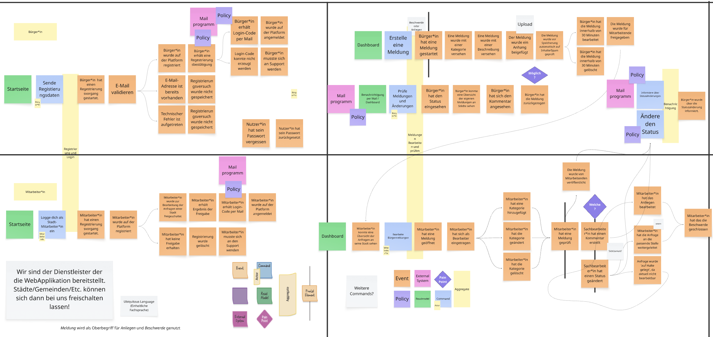
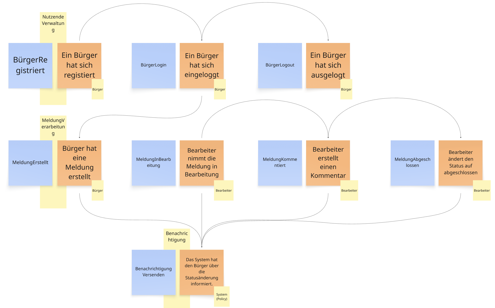
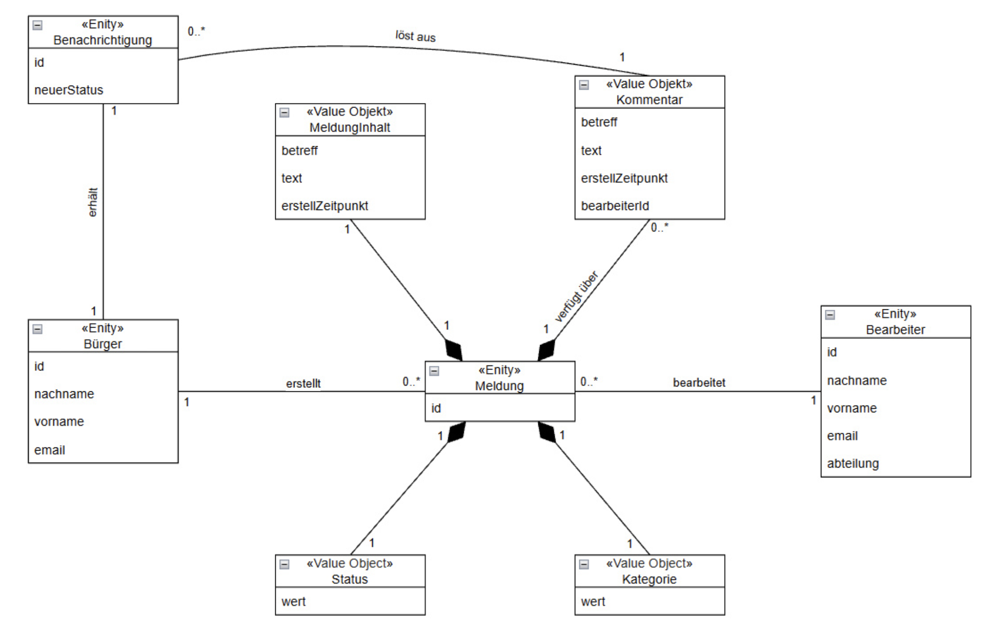
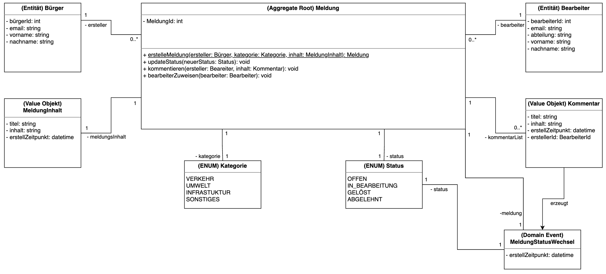

# Master Medieninformatik (online) // Moderne Softwareentwicklung
## CityFeedback // Team 7 

## 1. Event Storming durchführen

Wir haben das Event Storming direkt zu dritt in einem Miro Board durchgefürt. Dabei haben wir uns in den ersten Minuten mit der Schaffung eines einheitlichen Verständnisses zu dem Vorgehen und der Aufgabenstellung beschäftigt. Dieser Punkt war uns wichtig, denn wir wollten zwar ein umfangreiches aber dennoch zielgerichtetes Storming durchführen.

In der nachfolgenden Abbildung 1 wird unser erste grobe Struktur gezeigt.


_Abb. 1 : Event Storming_ 

Nach weiteren Diskussionen und der Reduzierung der Komplexität sind wir bei der in Abbildung 2 gezeigten Zielbild des Event Storming einig geworden.



_Abb. 2 : Reduziertes Event Storming_ 

| Nr. | Akteur | Command | Event |
| :--- | :--- | :--- | :--- |
| **1** | Bürger | BürgerRegistriert | Bürger hat sich registriert |
| **2** | Bürger | BürgerLogin | Bürger hat sich eingelogt |
| **3** | Bürger | MeldungErstellt | Bürger hat eine Meldung erstellt |
| **4** | Bearbeiter | MeldungInBearbeitung | Bearbeiter nimmt die Meldung in Bearbeitung |
| **5** | Bearbeiter | MeldungKommentiert | Bearbeiter erstellt einen Kommentar |
| **6** | Bearbeiter | MeldungAbgeschlossen | Bearbeiter ändert den Status auf abgeschlossen |
| **7** | System (Policy) | BenachrichtungVersenden | Das System hat den Bürger über die Statusänderung informiert. |

**Ablauf und Reaktionen:** Die Registrierung und der Login ist Voraussetzung für das Erstellen einer Meldung. Bei einer Statusänderung durch einen neuen Bearbeiterkommentar, den Abschluss der Bearbeitung oder der Meldungserstellung reagiert eine Anwendungs-Policy auf das jeweilige Event und veranlasst eine Benachrichtigung an den meldenden Bürger.

---
## 2. Domain-Modell (grobe Gesamtsicht)

Eine **Meldung** hat einen Lebenszyklus und eine ID. Ein **Kommentar** hat keine und wird über seine Werte einzigartig, gehört fachlich zur Meldung und wird über deren Aggregate Root verwaltet. Status und Kategorie sind kontrollierte Wertebereiche.


_Abb. 3 : Domain-Modell Klassendiagramm_ 

**Beziehungen:** Ein Bürger kann mehrere Meldungen einreichen. Eine Meldung kann von mehreren Bearbeitern, aber immer nur einer zur Zeit, bearbeitet werden. Der Meldungsinhalt, sowie die Kommentare sind Value Objekts, die in der Entität Meldung zusammengeführt werden. Dazu kommen die Werte aus Kategorie und Status. Ein durch den Bearbeiter erstellter Kommentar löst eine Benachrichtigung an den der Meldung zugeordneten Bürger aus.

---

## 3. Bounded Contexts

In unserem Fall haben wir drei Bounded Contextes identifiziert und definiert.

| Bounded Context | Verantwortung | Wichtige Events |
| :--- | :--- | :--- |
| **Core**<br>Meldungsverwaltung | Die Geschäftsprozesse rund um die Meldung. Erstellung, Statusänderung, Kommentierung | Statusänderung |
| **Support**<br>Benachrichtungsverwaltung | Benachrichtigungssystem für die Bürger über Änderungen | Benachrichtigung |
| **Generic**<br>Nutzerverwaltung | Registierung und Login - alles Rund um die Verwaltung der Nutzenden | Registration/Login |

---

## 4. Entitäten und Aggregates definieren (Detail pro Context)

Aus den vorangegangenen Informationen haben wir nachfolgende Entitäten und Aggregate Roots erstellt.


_Abb. 4 : Darstellung der Entitäten und Aggregate Root_ 

**Statusregeln:** Als einfacher Workflow gilt `EINGEREICHT -> IN_BEARBEITUNG -> KOMMENTIERT -> ERLEDIGT` oder `ABGELEHNT`. Ein erneuter Statuswechsel aus `ERLEDIGT` oder `ABGELEHNT` ist in diesem Entwurf nicht vorgesehen. Die Berechtigung, Status und Kommentare zu ändern, wird zusätzlich im Anwendungsservice geprüft, da sie vom angemeldeten Bearbeiter abhängt.

---

## 5. Domain Services und Repositories

### Services

| Service | Art | Aufgabe | Methoden |
| :--- | :--- | :--- | :--- |
| **BuergerService** | Anwendungsservice | Registriert Bürger und prüft die Eindeutigkeit der E-Mail-Adresse. | `registrieren(name, email): BuergerId` |
| **MeldungService** | Anwendungsservice | Erstellt Meldungen und steuert die Zuordnung eines Bearbeiters. | `einreichen(): MeldungsId`<br>`inBearbeitung(): BearbeiterId` |
| **BenachrichtigungPolicy** | Domain Event Handler | Reagiert auf Status- und Kommentarereignisse und veranlasst eine Nachricht an den meldenden Bürger. | `beiStatusGeaendert(event)`<br>`beiKommentarHinzugefuegt(event)` |

### Repositories

| Repository | Aggregate | Methoden |
| :--- | :--- | :--- |
| **BuergerRepository** | Buerger | `save(Buerger)`<br>`findById(BuergerId): Optional<Buerger>`<br>`existsByEmail(EMail): boolean` |
| **MeldungRepository** | Meldung | `save(Meldung)`<br>`findById(MeldungId): Optional<Meldung>`<br>`findByMelderId(BuergerId): List<Meldung>` |


---

## 6. Implementierungsstrategie

### Vorgehen
1. **Fachliche Abläufe zuerst testen:** Registrierung, Einreichen, Statuswechsel und Kommentar als Anwendungsfälle festhalten.
2. **Von innen nach außen:** Value Objects und Aggregate implementieren, anschließend Repository-Schnittstellen, Application Services und Infrastruktur.
3. **Test-first:** Invarianten wie ungültige Statusübergänge und leere Kommentare mit Unit-Tests absichern.
4. **Events nach Änderungen veröffentlichen:** Erst nach erfolgreichem Speichern wird eine Benachrichtigungs-Policy über Status- oder Kommentaränderungen informiert.
5. **Kontextgrenzen erhalten:** Bürger- und Meldungsverwaltung greifen nur über IDs und definierte Schnittstellen aufeinander zu.
6. **Domäne frameworkfrei halten:** Fachliche Regeln und Value Objects benötigen keine Spring- oder Datenbank-Abhängigkeit.

### Umsetzung
Programmiersprache: Java<br>
Framework: Spring Boot 

### Paketstruktur (Java)

```text
src/main/java/
└── de/projekt/meldungssystem/
    ├── domain/
    │   ├── model/
    │   │   ├── Meldung.java
    │   │   └── Kommentar.java
    │   ├── repository/
    │   │   └── MeldungRepository.java
    │   └── service/
    │
    ├── application/
    │   ├── service/
    │   │   └── MeldungService.java
    │   └── dto/
    │
    ├── infrastructure/
    │   └── persistence/
    │       └── JpaMeldungRepository.java
    │
    └── interfaces/
        └── rest/
            └── MeldungController.java

```